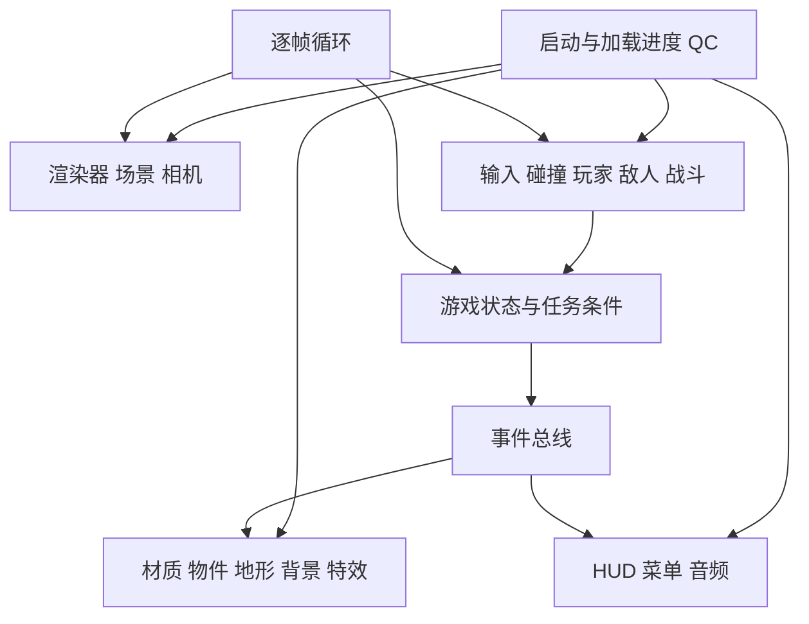
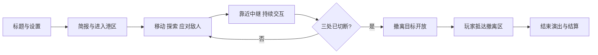
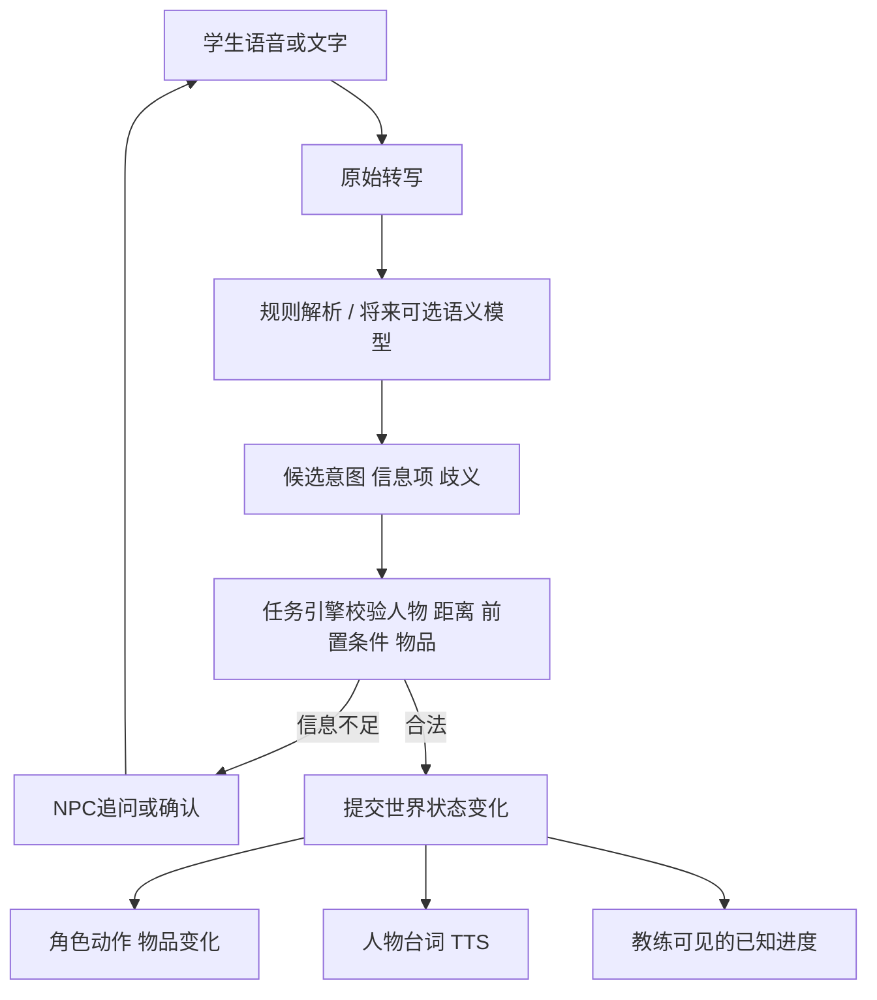

# 《几猫3A大作》网页实现分析与 Campus Quest 场景化方案

日期：2026-11-11。状态：源码分析完成；英语游戏方案待讨论、未实施。

## 1. 结论与分析边界

这个文件展示了：浏览器可以用一个 HTML 承载有空间、人物动作、任务推进和完成反馈的 3D 游戏。其基础是 **Three.js r180 + 原生 JavaScript + 自定义游戏系统**。文件名中的“3A”是作品名称，不能据此判断制作预算或工业级品质。

Campus Quest 可以采用相同的“世界场景 + 人物交互 + 确定性任务状态”结构，把说英语变成在世界里办事的手段。最有价值的迁移不是枪战、写实特效，而是：**学生说清需求，人物作出回应，物品和世界发生变化，学生亲自完成交付。**

本次只做静态源码审读与现有项目对照，没有启动该文件试玩，没有测量帧率、内存、移动端体验或音效听感。以下把源码事实、推断和建议分开描述；未修改游戏程序。

分析对象：[几猫国产3A大作_V1(1)(2).html](/Users/Admin/Downloads/几猫国产3A大作_V1(1)(2).html)。文件大小 1,425,707 字节，6,214 行，包含大量压缩长行。SHA-256：`9e55b5200b088adaf8e1152da04efc0d3b25e236e6baf2dee96f81e23e084966`。

## 2. 框架、模型与依赖

### 2.1 技术构成

| 部分 | 文件中的实现 | 判断依据 |
|---|---|---|
| 3D 渲染库 | 内置 Three.js r180 | 导出的 REVISION 对应 `M2="180"`，使用 WebGLRenderer、Scene、PerspectiveCamera 等 |
| 页面界面 | 原生 HTML、CSS、DOM | canvas 绘制世界；独立 DOM 显示菜单、任务、准星、设置、通信文字 |
| 游戏框架 | 自定义模块，不是整套现成游戏引擎 | render、physics、input、player、combat、weapon、enemies、hud、game 等在启动函数中组装 |
| UI 框架 | 未发现 React/Vue 应用代码 | 通过 createElement、innerHTML、classList 操作界面 |
| 物理与导航 | 自定义包围盒碰撞、射线检测和网格路径查找 | `d3()` 提供 boxes、raycast、nav.findPath 等接口 |
| 声音 | Web Audio API，程序生成音频缓冲 | `c_()` 创建 AudioContext，`u_()` 调用合成函数并缓存 AudioBuffer |
| 任务编排 | 状态机、前置条件、事件总线 | `mM()`、`Dy()`、objective:done、objective:all 等 |
| 存储 | localStorage 保存设置 | 画质、灵敏度、反转 Y、音量、视角；不能据此声称完整关卡存档已实现 |
| 分发 | CSS、库、业务脚本内联到单 HTML | 只有一个内联 script，没有外链 script 或 link；原始构建工具无法从产物可靠确定 |

Three.js 是渲染基础，任务、输入、碰撞、人物行为仍是作者自己的代码。官方文档列出了渲染器、网格、动画等 API，可用于理解这些职责，但本文件版本以源码的 r180 为准，不能拿当前文档反推其全部行为：[Three.js 文档](https://threejs.org/docs/)。

### 2.2 “模型”要分三种

**3D 模型：** 文件中有几何体组合、程序化网格、材质和骨骼绑定代码。场景物件注册表按名称构建集装箱、中继、港区设施等；敌人包含机械飞鸥、机械猎犬、机械守卫。可见 `SkinnedMesh`、`Skeleton` 的实际创建和骨骼装配。未发现 GLTFLoader/FBXLoader 加载调用，因此不能把它描述为下载一套现成人物模型后展示。库中出现某个格式字符串，也不等于业务实际使用了该格式。

**游戏行为模型：** 敌人通过 patrol、alert、investigate、search 等状态、视线判断、最后已知位置、移动路径和攻击节奏作出反应。这是传统游戏 AI，不是大语言模型，也不是学习型智能体的证据。

**生成式 AI 模型：** 未发现 OpenAI、Ollama、ONNX 推理或业务网络模型调用。无法从最终 HTML 判断作者是否用 AI 辅助写代码，更无法推断用了哪个模型、提示词或成本。运行时不依赖大语言模型，与制作时可能使用 AI 是两回事。

### 2.3 为什么一个文件能包含这么多内容

代码生成几何体与材质纹理，复用物件构造器，以数值和规则描述细节；Web Audio 合成声音；Three.js 和业务代码一起打包。因此文件较小不等于场景简单，也不代表运行开销低。启动时仍要生成资源、编译着色器、分配 GPU 纹理和缓冲。真实资源占用必须实际测量。

## 3. 整体运行架构

### 3.1 启动与循环

`QC()` 建立共享上下文，按依赖顺序创建 render、mats、physics、props、input、level、backdrop、ground、fx、audio、player、combat、weapon、enemies、hud、game。

启动页显示资源准备阶段。一些非关键模块失败时有 stub 降级对象；渲染器与关卡等关键失败会进入 fatal 提示。正式运行使用 `renderer.setAnimationLoop()`；逻辑步长上限为 0.05 秒，避免卡顿后单步运动突变。暂停时停止主要玩法推进，界面等仍可更新。

### 3.2 场景与画面

场景是人工编排位置与程序化细节相结合，并非每次临时生成一个新故事。`C1()` 布置港区、仓库、码头和三个中继，注册目标与撤离位置；随机种子用于可复现的细节和行为变化。

物件构造器不仅返回外观，还提供尺寸、碰撞盒、材质以及部分物件的状态切换接口。静态几何按条件合并，动态或骨骼物件单独保留。视觉层包含阴影、湿润表面、雾、泛光、镜头光效和后期处理；这些共同制造完整游戏的观感。

画质有多档配置，能参考设备信息选择初值，也有动态分辨率与降档逻辑。源码有 benchmark 模式、帧率和渲染统计入口，但这不代表该文件已在当前设备通过性能验收。

### 3.3 输入与行动

桌面端提供 WASD、鼠标视角、射击、瞄准、换弹、跳跃等；代码统一维护 key/mouse/touch/pad 输入来源。鼠标捕获失败有替代转向模式，触屏有虚拟控制按钮。失焦、暂停等情况会清理输入，避免角色持续行动。

与中继交互同时检查距离、高差和朝向。配置交互距离为 2.2 个世界单位，按住交互键约 2.4 秒才能切断；中断时进度回退。反馈包括交互提示、进度、设备状态、音效和任务计数。

这个“输入—条件校验—世界变化—反馈”的结构可以借鉴；英语交流不应照搬按住 2.4 秒或严苛的瞄准要求。

### 3.4 通信与声音

`hud.radio()` 将 `{text, secs}` 放入队列，按时显示预设文字。AudioContext 系统响应任务、战斗、环境等事件播放声音。未发现 speechSynthesis 或 SpeechRecognition。

因此它有“指挥中心在陪伴”的叙事效果，但不是能听懂玩家语言、生成回答并说话的 NPC 系统。Campus Quest 的 ASR、TTS、对话上下文仍需独立接入。

## 4. 游戏如何组织剧情、目标和完成

### 4.1 一局的核心循环

任务目标固定为三处中继，最后撤离。交互函数遍历尚未切断的中继选择附近目标，未见必须按甲乙丙顺序完成的限制；阶段变化按已完成数量推进。它属于固定目标下的空间行动自由，不是开放式故事生成。

### 4.2 多层状态

| 层级 | 状态或数据 | 意义 |
|---|---|---|
| 会话 | title / intro / playing / paused / dead / complete | 规定当前允许哪些输入和更新 |
| 任务 | 各中继 cut、cut 数量、allCut | 控制阶段、导航标记和撤离资格 |
| 物件 | live / cutting / cut | 任务结果落实到可见设备 |
| 玩家 | alive、health、位置、移动状态 | 决定能否行动与抵达终点 |
| 敌人 | 巡逻、警戒、搜索等 | 营造行动中的压力和响应 |

切断一个中继会更新设备、发出 `objective:done`、增加计数、安排敌人波次并更新通信内容。全部切断触发 `objective:all`，开放撤离标记和追击阶段。提前到撤离区只收到提示，不能完成。

完成判定在游戏逻辑中，要求全部目标已完成、玩家存活且到达撤离区域。完成后关闭玩法输入、播放结束反馈，再展示统计。结算根据用时、命中率、重试数形成称号。英语学习不应照搬这些考核，也不应因重听、慢速或求助扣星；保留我们默认三颗星的约定。

### 4.3 值得借鉴和不宜照搬

值得借鉴的是事件驱动、物件状态变化、靠近才交互、任务完成前置条件，以及完成后的明确收尾。它们让玩家知道自己的行动产生了什么结果。

不宜照搬的是战斗压力、写实枪械、复杂镜头操作、大量后期特效和提前暴露所有目标位置。我们的注意力预算应给听懂、表达和推理；未知目标仍应在获得线索后、走近时才被发现。

## 5. 对照 Campus Quest：现在有什么，还缺什么

依据当前 `dist/app.js`、`scene-engine.js`、`generated-story.js`、`world.js` 及项目文档核对。

| 能力 | 当前状态 | 场景化仍需补充 |
|---|---|---|
| 学生移动与 NPC 接近 | 已有二维 DOM 地图、位置与距离判断 | 可替换成可行走的 3D 小场景，补真实障碍与通行 |
| 人物 | emoji 角色、问号、喇叭、跟随教练 | 统一人物外观、朝向、站立/行走/听/说/递交动作 |
| 语音 | 本地 VAD；4174 Whisper small；浏览器 TTS；其他环境浏览器 ASR | 场景中的人物状态与真实录音/播放状态同步 |
| 对话 | 有限规则、信息项累积、纠正和缺项追问 | 处理更多合理表达需单独评估语义理解，换 3D 不会自动解决 |
| 课程生成 | 本地 Qwen3.5 9B 提取与生成配置 | 扩展物件、前置条件和世界效果配置，而非让模型生成任意游戏代码 |
| 任务 | 原始 Pip 有发现与跟随；通用故事主要按 actions 线性完成 | 通用引擎加入领取、携带、交付等真正的动作类型 |
| 反馈 | 阶段标记、信息圆点、感谢、庆祝 | 桌面物品出现、被学生拿走、交到人物手中等可见结果 |
| 教练 | 脚本提示与陪伴 | 保持只读任务权限；真人联机与开放式 AI 教练仍未实现 |

近期加的“已完成收集”提示不是物品背包或场景交付系统，不能将其当成已经实现物件玩法。

## 6. 建议的英语游戏方案

### 6.1 场景与镜头

建议做一个独立的 **Three.js 低多边形 3D 餐厅试验场景，采用固定斜俯视镜头**。这样能同时看见学生、教练、服务员和物品，沿用点击地面行走与键盘移动，减少第一人称镜头操作对听说的干扰。这里的“2.5D 视角”指真实 3D 世界配固定镜头，不是另外一种引擎。

先保留现有二维入口作对照和回退，验证一条任务闭环后再考虑推广。场景只需要柜台、桌椅、同伴位置和取餐位置；无枪战、无大世界、无复杂光效。人物可先用程序化简模验证动作和距离；之后再换为统一骨骼的美术资产。最终的人物质量取决于模型、动作和绑定，不能仅靠换渲染库获得。

### 6.2 人物设计

| 人物 | 作用 | 可见行为 | 任务权限 |
|---|---|---|---|
| 学生 | 行动主角 | 行走、面向人物、拿取、携带、交付 | 唯一可提交任务动作的角色 |
| 同伴 Lily | 发委托、调整需求、接收午餐 | 招手、说话、接物、感谢 | 按任务规则提供信息与接收物品 |
| 服务员 | 告知售罄、确认订单、提供午餐 | 听、追问、说话、把餐袋放上台面 | 只处理当前条件允许的订单 |
| Nova 教练 | 跟随、分析、语言帮助 | 跟随、停步、面对学生、说话 | 不领取、不代答、不拿取、不交付 |

人物至少区分 idle、walk、listening、processing、speaking、handover。processing 表示系统正在处理，不包装成“AI 正在思考”。初版说话动作可以是轻微手势和嘴部开合，不声称实现准确音素口型。

### 6.3 对话入口与最低操作成本

学生走近 NPC，NPC 面向学生，头顶出现红色问号。点击人物或问号使用同一入口。委托人首次点击主动介绍任务；其他人物点击后开始录音。对话未完成继续保留问号，同时提供独立小喇叭重播最近一句。不要让学生每轮再寻找页面外的“开始提问”。

录音时显示清楚的收音状态，使用现有两秒静音结束策略，保留“说完了”和取消。处理时显示等待；角色说话时播放 TTS。开始录音前停止当前播音，避免把 NPC 自己的话识别成学生回答。对话期间暂停自动行走，移动键不得吞掉文字输入。

默认不显示完整台词、中文或标准答案。听不懂可以重播、慢速重播，再问教练。原始识别和学生录音在辅助面板中查看；候选解释与原始转写分开，不暗中改写用户的声音。

### 6.4 任务示例：野餐前的午餐变化

| 情节 | 学生必须做什么 | 人物回应/变化 | 完成条件 |
|---|---|---|---|
| 开场 | 主动开始并完成语言准备 | 教练说明场景和先找 Lily | 不在此处透露完整需求答案 |
| 领取委托 | 走近 Lily，点问号听任务 | Lily 说想要什么 | 已听取委托，记入可重听信息 |
| 获取变化 | 走到柜台，询问食物情况 | 服务员说明鸡肉售罄 | 相关询问成功，获得变化信息 |
| 商量替代 | 回到 Lily 汇报并询问 | Lily 提出替代食物和限制 | 变化、替代选择等必要信息已交流 |
| 点餐 | 分轮说清食物、饮料、不要的配料 | 服务员只追问缺项；说清后餐袋出现在柜台 | 所有必需信息已确认且商品可提供 |
| 取餐 | 学生靠近餐袋主动拿取 | 餐袋从柜台转移到学生身上 | 持有有效订单对应的物品 |
| 交付 | 回到 Lily 汇报，并主动交给她 | 餐袋转移；Lily 感谢；庆祝与三颗星 | 汇报条件、物品、位置和交付动作均成立 |

点餐允许先饮料后食物，也允许一次说完。比如先说 “Water, please”，再说 “A cheese sandwich”，最后回答配料问题，不能要求从头重说。更正一项保留其他项。

需要练习汇报的故事，最终一句可以是 “Here is your lunch” 或合理的已完成表达；需要多个事实的故事则继续收集必需事实。**一旦所有条件成立，立即感谢和完成，不能又要求学生问 Have you seen…** 不需要练习汇报的模板可以只要求主动交付，不额外增加口语门槛。

避免冗余操作：最终有效汇报后，可直接显示人物附近唯一的“交给 Lily”按钮；点击即提交交付，无需另开背包菜单或二次确认。

## 7. 对话与任务引擎如何连接

### 7.1 渲染层不能决定过关

场景只负责呈现和输入，把 `interact(npcId)`、`pickup(itemId)`、`deliver(itemId,npcId)` 等动作交给任务引擎。引擎验证后更新状态，渲染层据此播放动画。动画被跳过、掉帧或页面刷新，不得重复发物品或完成两次。

建议增加独立的 world-state 与 scene-adapter 模块；原始 Pip 与通用故事已有不同实现，不能假定更换一个地图组件就全部兼容。先仅接通样板故事。

### 7.2 任务状态需要扩展

建议新增以下概念，属于未来设计，不是当前 JSON 可直接使用的字段：

| 状态 | 用途 |
|---|---|
| knownFacts | 学生实际获得的事实及来源，不把隐藏答案传给教练 |
| dialogueDraft | 当前人物/步骤下已确认、缺失和待确认的信息 |
| worldObjects | 物件位置、可见性、是否允许交互 |
| itemOwner | 物品属于柜台、学生或接收人物；唯一归属 |
| order | 已确认内容、备餐状态和对应物品 ID |
| taskFlags | 已领委托、已获变化、已订餐、已交付等 |
| appliedEvents | 防重复点击和重复语音回调的事件标识 |

规则示例：点餐信息齐全只能使餐袋在柜台出现，不能直接把最终任务标为完成；学生说“我已经拿了”不能绕过真实拿取；教练说同一句话也不能更新学生任务。回主页重置本局，音色和语速偏好保留。

### 7.3 模型的选用边界

第一阶段复用现有 Whisper small、浏览器 TTS、有限规则；课程生成仍是编辑阶段使用 Qwen3.5 9B。3D 场景本身不需要新增 AI 模型，也没有必然的逐轮模型 API 费用，但会增加资产制作、渲染开发和设备验收成本。

更自然的改述理解是另一个技术问题。若之后引入语义模型，只让它返回候选意图与信息项，不能直接写 `questComplete=true`；低置信度、矛盾和未知内容必须追问。新模型需要单独比较延迟、成本、隐私和错误通过率，未经范围确认不接入。

## 8. 模板如何支持快速生成

沿用“课文/图片 → 提取学习重点 → 作者确认 → 生成故事配置 → 检查 → 试玩”。增加的应是受约束的场景配置能力：地图模板 ID、人物角色与出生点、物件类型、任务前置条件、可用效果、动作演出和学习目标映射。

例如有限效果类型可包括 `revealObject`、`placeItem`、`transferItem`、`setNpcState`、`completeQuest`。这些是设计建议，尚未接入现有校验器。生成器只能选择允许的类型及已有资产，不生成任意 JS、着色器或下载地址。

从当前线性 actions 迁移时先做版本化：旧故事仍走旧引擎，新版本支持对话与物品动作。缺少世界效果的老故事不能冒充已经有交付玩法，也不能把旧进度强行套入新步骤。

## 9. 最小实施范围与验收

建议第一轮只交付一张餐厅地图、学生/Nova/Lily/服务员四个角色、一种餐袋、完整点餐交付闭环。先使用现有故事内容与语音链路，不同时扩展课程生成器、多场景、真人联机或完整语义 AI。

| 验收类别 | 必须验证 |
|---|---|
| 人物与场景 | 可键盘/点击行走；不能穿过柜台；走近才可交互；教练跟随不挡路 |
| 多轮对话 | 任意顺序补齐；只改一项；拒绝无关、否定、未来承诺；Yes 不填满整个任务 |
| 语音状态 | 播音和录音不互相污染；可重听慢放；取消/失败/迟到回调不推进 |
| 世界效果 | 点餐后出现餐袋；学生拿取后柜台消失；交付后从学生转到 Lily |
| 防捷径 | 直接到 Lily、空手汇报、教练代答、重复点击都不能虚假完成 |
| 完成体验 | 达成条件立即感谢、庆祝和默认三颗星，不再追问旧任务 |
| 状态一致性 | 内部导航保留局内状态；返回主页重置；刷新不会复制物品或套错故事版本 |
| 设备表现 | 实测一台目标电脑和一台目标手机，记录加载、帧率、发热与录音同时运行情况；目标值待设备基线后确定 |

实施先验证人物行走与交谈入口，再接对话引擎，最后验证物品转移和完整闭环。每阶段都复用同一条样板流程，不为每个视觉微调部署。只有用户确认实施范围后开发，默认仍只本地预览。

## 10. 参考代码定位

压缩文件同一行可能包含多个函数，因此“函数名 + 文件指纹”比单独行号可靠。以下定位针对本文分析的原文件，未复制或改写该文件。

| 证据 | 源码定位 |
|---|---|
| Three.js r180 | 第 360 行，`var M2="180"` |
| 事件总线 | 第 4191 行，`function Dy(` |
| WebGL 渲染及相机 | 第 4744 行，`function Hg(` |
| 程序化材质 | 第 5453 行，`function Gg(` |
| 碰撞与导航 | 第 5453 行，`function d3(` |
| 物件注册与构建 | 第 5453 行，`function Yg(` |
| 港区关卡布置 | 第 5453 行，`function C1(` |
| 音频合成/输入/玩家 | 第 5939 行，`c_`、`u_`、`v_`、`x_` |
| 敌人与骨骼构建 | 第 6065 行附近，`function Em(` 及 `new ka(` |
| HUD 和文字通信队列 | 第 6087 行，`function hM(`、`radio(k,ce=4.5)` |
| 任务参数、状态机、启动 | 第 6202 行，`var Yi=`、`function mM(`、`async function QC()` |

现有项目关联：[设计记录](design.md)、[模板设计](story-template-design.md)、[任务引擎](../dist/scene-engine.js)、[生成故事规则](../dist/generated-story.js)、[Pip 世界逻辑](../dist/world.js)。

复用建议以结构与交互原理为主；文件未提供明确的业务源码授权信息。若将来直接复制它的完整代码或资产，需要先确认来源与复用许可。本轮没有复制其业务代码进入应用。

## 11. 现代校园首关设计确认（2026-11-12）

用户确认：产品采用现代场景冒险，每个独立委托对应一关。餐厅保留为交互试验页，正式首关为「未来校园：取回科技展设备」。本节是设计基线，尚未实现该关卡。

地图包含连通的校园大厅、服务台、科技展厅与实验室，采用玻璃隔断、电子屏、绿植与展台形成现代校园风格。学生自主移动和探索；Nova 跟随、解释与分析，不代答或操作任务。

| 情节 | 学生的英语交互与行动 | 世界状态变化 |
|---|---|---|
| 开场准备 | 选择音色语速、学习本关表达；听 Nova 介绍环境和领取任务计划 | 用户主动开始后开放场景操作 |
| Mia 发布委托 | 走近负责人，点问号听设备特征和用途 | 领取一项委托，Mia 变文本标记；不提前显示目标位置 |
| 服务台询问 | 向 Ben 询问设备去向 | 获得设备已经转移到实验室的信息 |
| 追查变化 | 根据线索找到 Leo，询问转移原因和领取要求 | 获得核对条件，尚未取得设备 |
| 核对领取 | 分轮说清设备特征和用途，允许乱序与更正；主动拿取 | 核对成功后设备才可领取，归属转到学生 |
| 返回交付 | 携带设备回到 Mia 身边，汇报并主动交付 | 设备转到展台，展台亮起；人物感谢、庆祝，默认三颗星 |

每个人物一次只处理当前一项要求：问号开始交流，说完任务变文本标记，点击在人物旁展开英文并可重听，× 关闭。当前要求完成后，有后续交流才恢复问号。完整台词和中文默认收起，听力优先。

场景中的人物、物件及状态变化承载任务，页面仅保留必要的录音与辅助操作。点击地面行走、键盘移动、点击人物走近，路径需绕开障碍。设备在领取、携带与交付中保持唯一归属，不能空手汇报过关。

本轮范围：一张现代校园地图，一条完整任务闭环，复用现有语音和有限规则对话。开放式 AI 人物、真人联机、多关批量生成另行讨论。设备细节及语言配置在关卡内容设计时确定，准备页不直接展示隐藏答案。

验收：真实浏览器走完领取、询问、追查、核对、拿取、返回和交付；另查无关回答、缺项追问、更正、重复拿取、空手交付及文本开关不推进任务。引擎测试和浏览器试玩分别记录。当前阶段为设计已确认、待实施；默认本地预览。
